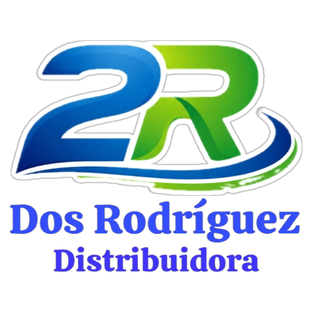

<div align="center">



# 2 Rodríguez Distribuidora
### Plataforma de Gestión Comercial, Portal B2B/B2C & Inteligencia Financiera

*Solución integral desarrollada a medida para centralizar el catálogo maestro, blindar márgenes comerciales, automatizar pedidos mayoristas y erradicar las planillas manuales de Excel.*

---

<!-- Badges Banner de Tecnologías -->
[](https://www.python.org/)
[](https://fastapi.tiangolo.com/)
[](https://astro.build/)
[](https://tailwindcss.com/)
[](https://www.typescriptlang.org/)
[](https://www.postgresql.org/)
[](https://www.docker.com/)
[](https://astral.sh/uv)
[](https://pnpm.io/)
[](https://github.com/P-H-C/phc-winner-argon2)

<p align="center">
  <b>Punto de Retiro: Ángel Salvo 56 (Ferretería junto a la vía del tren, Paso Molino, Montevideo)</b><br />
  <b>Email: dosrodriguezdistribuidora@gmail.com</b> • <b>WhatsApp Comercial: +598 95 250 673</b>
</p>

</div>

---

## 🎯 Visión y Propósito del Sistema

El negocio operaba históricamente sobre un archivo Excel de 311 productos, con múltiples listas de precios y 19 conflictos matemáticos de margen. Esta plataforma moderna sustituye la complejidad manual por un ecosistema web seguro, accesible desde computadoras, tablets y celulares:

```
┌─────────────────────────────────────────────────────────────────────────────┐
│                       Ecosistema 2 Rodríguez                                │
├─────────────────────────┬─────────────────────────┬─────────────────────────┤
│    Catálogo Público     │     Área de Clientes    │  Gestión Administrativa │
│   (/ y /catalogo)       │       (/portal)         │        (RBAC / JWT)     │
├─────────────────────────┼─────────────────────────┼─────────────────────────┤
│ • Precios protegidos    │ • Precios mayoristas    │ • Control 311 artículos │
│ • Pedidos WhatsApp      │ • Despacho prioritario  │ • Alertas stock crítico │
│ • Retiro en Paso Molino │ • Historial de pedidos  │ • Rentabilidad mensual  │
│ • Blindaje proveedores  │ • Descuento de stock    │ • Export/Import Excel   │
└─────────────────────────┴─────────────────────────┴─────────────────────────┘
```

---

## ✨ Características y Módulos Destacados

### 1. 📦 Control de Inventario & Alertas Tempranas (Pilar 1)
- **Descuento Atómico**: En cada orden confirmada, el stock se decrementa bajo transacciones ACID con bloqueo pesimista (`SELECT ... FOR UPDATE`), evitando sobreventas.
- **Semáforo Visual**: Indicadores en tiempo real (Rojo = Agotado, Amarillo = Stock Crítico $\le$ umbral, Verde = Disponible).
- **Ajuste Express**: Modal instantáneo para modificar existencias físicas sin recargar la página.

### 2. 🛡️ Blindaje de Proveedores & Exportación Excel (Pilar 2)
- **Secreto Comercial Garantizado**: La información de costos y proveedores (orígenes de mercadería, listas de costo y márgenes brutos) está estrictamente restringida a nivel de base de datos y serializador. Los contratos de cliente y público omiten estos campos de forma hermética.
- **Exportación de Catálogo Excel/CSV**: Descarga con formato `UTF-8-BOM` y separador `;`, garantizando apertura limpia en Microsoft Excel sin deformar tildes ni caracteres uruguayos.
- **Carga Masiva Drag & Drop**: Zona para arrastrar planillas CSV y actualizar cientos de productos en segundos.
- **Archivos Multimedia**: Carga directa de fotos de artículos y fichas técnicas en PDF por arrastre.

### 3. 📊 Mini-Contabilidad & Gráfica de Rentabilidad (Pilar 3)
- **Aritmética Financiera Estricta**: Cálculos basados en `Decimal` (cero flotantes con pérdida de precisión).
- **Métricas Consolidadas**:
  $$\text{Margen Bruto} = \text{Facturación Bruta} - \text{Costo de Mercadería Vendida (COGS)}$$
  $$\text{Ganancia Neta} = \text{Margen Bruto} - \text{Gastos Operativos}$$
- **Gráfica de Rentabilidad Nativa SVG**: Visualización responsiva y ultra-liviana de la evolución de los últimos 6 meses comparando ingresos, egresos y beneficio neto.
- **Gestor de Gastos Operativos**: Registro ágil clasificado por rubro (Alquiler Paso Molino, Fletes, Packaging, BPS/DGI, Sueldos).

### 4. 🧾 Presupuestos Corporativos Formales en PDF
- Emisión inmediata de presupuestos PDF vía **ReportLab** con logo corporativo, membrete oficial, desglose de ítems con IVA y exclusión absoluta de costos internos.

---

## 🏛️ Arquitectura Hexagonal del Backend

```
backend/
├── src/
│   ├── domain/               # Entidades de negocio, enums y servicios puros
│   │   ├── models/           # Product, Order, Expense, CommercialList
│   │   └── services/         # PricingService, FinancialService (Decimal)
│   ├── application/          # Casos de uso y DTOs de Pydantic v2
│   │   ├── dtos/             # Schemas tipados sin Any
│   │   └── use_cases/        # Catalog, Orders, Finances, Quotes, Attachments
│   ├── infrastructure/       # Adaptadores de entrada y salida
│   │   ├── api/v1/           # Controladores FastAPI (Auth, Admin, Portal, Finances)
│   │   ├── db/               # PostgreSQL, SQLAlchemy ORM y migraciones Alembic
│   │   └── security/         # Hasheo Argon2id y tokens JWT
│   └── main.py               # Ensamblador de la aplicación y middlewares CORS
```

---

## ⚡ Guía de Inicio Rápido (Local)

### 1. Clonar el repositorio
```bash
git clone https://github.com/Ponce1969/E-commerce-MVP.git
cd E-commerce-MVP
```

### 2. Base de Datos (Docker)
```bash
cd backend
docker compose up -d
```
> La base de datos queda expuesta de manera aislada en el puerto `5436` para evitar colisiones con otros servicios PostgreSQL locales.

### 3. Servidor Backend (FastAPI + uv)
```bash
cd backend
uv run alembic upgrade head
uv run uvicorn src.main:app --host 127.0.0.1 --port 8000 --reload
```
- **Documentación Interactiva Swagger**: [http://localhost:8000/api/v1/docs](http://localhost:8000/api/v1/docs)

### 4. Servidor Frontend (Astro 5 + Tailwind)
```bash
cd frontend
pnpm install
pnpm run dev --host 127.0.0.1 --port 4321
```
- **Plataforma Web & Catálogo**: [http://localhost:4321](http://localhost:4321)
- **Área de Clientes**: [http://localhost:4321/portal](http://localhost:4321/portal)
> *Nota de Seguridad*: La consola administrativa interna y las rutas de gestión se encuentran restringidas y protegidas mediante tokens JWT y control de acceso basado en roles (RBAC).

---

## 🚀 Despliegue en Producción (Orange Pi / Ubuntu Linux)

El stack está preparado y optimizado para ejecutarse en placas **Orange Pi (ARM64)** o servidores Linux con consumo mínimo de RAM:

```bash
# 1. Generar entorno seguro con claves de alta entropía
python3 scripts/setup_production_env.py --domain https://tu-dominio.uy

# 2. Configurar la clave de Resend en el archivo protegido
nano backend/.env  # Colocar tu RESEND_API_KEY=re_...

# 3. Construir y levantar la pila productiva en segundo plano
docker compose -f docker-compose.prod.yml up -d --build
```

- **PostgreSQL 16 Alpine**: Base de datos aislada con healthchecks y volumen persistente `postgres_data`.
- **Backend FastAPI**: Auto-migraciones con Alembic al iniciar y almacenamiento persistente de fotos/PDFs en `web2r_uploads`.
- **Frontend Nginx + Astro**: Proxy reverso de alto rendimiento en puerto 80 (consumo < 25 MB RAM) con compresión Gzip y ruteo interno a `/api/` sin problemas de CORS.

---

## 🧪 Pruebas Automatizadas y Calidad

El proyecto cuenta con un pipeline estricto de calidad de código:

```bash
# Backend (Pruebas unitarias e integración)
cd backend
uv run pytest -v

# Linter y formateador (Ruff)
uv run ruff check .

# Tipado estático estricto (Mypy)
uv run mypy src tests

# Frontend (Compilación estática Astro)
cd frontend
pnpm run build
```

---

## 💳 Formas de Pago Soportadas

- **Transferencia Bancaria BROU & Redes (Abitab / Redpagos)**: Canal de precio de lista bonificado sin costo financiero para comercios y empresas (datos de cuenta provistos en checkout o confirmación oficial).
- **Mercado Pago Oficial**: Financiación con tarjetas de crédito en hasta 12 cuotas con cálculo transparente de arancel de plataforma.

---

<div align="center">

Desarrollado con dedicación técnica y arquitectura sólida para **2 Rodríguez Distribuidora**.  
© 2026 Todos los derechos reservados.

</div>
